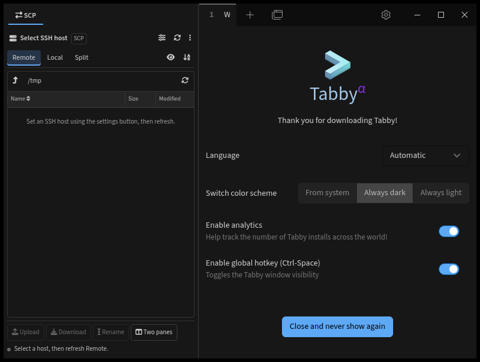
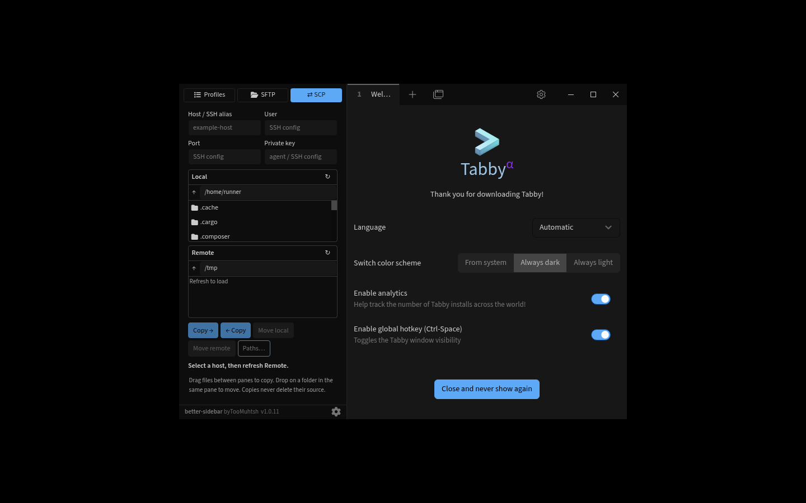

# tabby-sidebar-scp

**Standalone SCP file browser for [Tabby](https://tabby.sh).** Use it on its own, or
install it alongside [Better Sidebar](https://github.com/TooMuhtsh/tabby-better-sidebar).
**Better Sidebar is optional:** this plugin does not depend on it and never modifies
its repository or requires a fork.

> **Development status:** the SSH/SCP backend and the previous two-pane GUI
> passed GitHub Actions tests with Tabby 1.0.238. The redesigned SFTP-inspired
> interface still requires new VM screenshots and GUI verification. Test on a
> disposable SSH host before transferring important files.

## Where the SCP panel appears

| Environment | What you see |
| --- | --- |
| Better Sidebar is **running and its profile/SFTP view bar is present** | A third **SCP** tab next to **Profiles** and **SFTP** in Better Sidebar's header. Selecting SCP shows the SCP file browser in that same sidebar. |
| Better Sidebar is **not installed, disabled, or does not expose the expected header** | An **independent SCP sidebar**, with an SCP tab label at the top. It remains usable with native Tabby alone. |
| Better Sidebar appears/disappears while Tabby is running | The SCP browser moves between the two placements; it keeps its current component state. |

**Integration details.** Better Sidebar builds its own sidebar rather than
exporting a public plugin-view extension API. This plugin therefore detects
the existing `.sidebar-plus-content .view-mode-bar` element, adds an SCP tab,
and temporarily hides (without destroying) Better Sidebar's other view contents
while SCP is selected. Clicking **Profiles** or **SFTP** restores the original
contents. When the expected element is absent, SCP mounts as its own sidebar
inside Tabby's window instead. No Better Sidebar source files are changed.

**Compatibility warning:** the optional Better Sidebar integration uses DOM
selectors, **not an officially supported Better Sidebar API**. A future
version may change its classes or structure, in which case SCP falls back to
the standalone sidebar when the expected header cannot be found. A breaking
but still matching DOM change may also require an adapter update. Switching
to standalone mode does not affect the SCP engine.

This plugin does **not** use `BetterPanelContribution:<id>`, because that
contract registers settings pages, not sidebar file-browser tabs.

## File browser and operations

**Remote is the default SCP view**, styled after Better Sidebar's SFTP file
browser. A compact header shows the SSH connection, toolbar, editable path,
file filter and sortable **Name / Size / Modified** columns. Expand the SSH
settings when choosing a host, user, port or identity key.

Choose **Remote**, **Local**, or **Split** to switch between the remote browser,
local browser and two-pane transfer view. The same SCP interface is used
standalone and when Better Sidebar supplies the `Profiles | SFTP | SCP` tabs.

- **Remote (default):** browse remote directories, with folder navigation,
  hidden-file toggle, filtering and sort controls.
- **Local:** inspect local files and select uploads.
- **Split:** drag between panes to copy or onto a folder in the same pane to move.
- **Upload / Download:** copy the selected file or directory with legacy
  `scp -O`. An upload without a local selection opens the Local view.
- **Rename:** move or rename the selected file within its filesystem, after
  confirmation. **Right-click** on an entry for open/copy/rename actions.
- **Advanced transfer:** explicit source/destination paths, recursion,
  compression and timestamp preservation.

Every transfer and move asks for confirmation. A running SCP transfer can be
cancelled. See [SFTP-inspired UI design](docs/UI_PARITY.md) for the UI behavior
and integration boundaries.

**Copy is not move:** copying between local and remote never deletes the
source. Moves *within* the local or remote filesystem use local `rename` or
remote `ssh mv` respectively and attempt to reject existing destinations;
there is still a possible overwrite race, so avoid concurrent modifications.

### Requirements

- Compatible Tabby plugin runtime (target: Tabby 1.0.231+).
- A local OpenSSH client with **`ssh`** and **`scp`** binaries in PATH.
- `scp` must support `-O` (force **legacy SCP** protocol, not SFTP); the
  SSH server must support the legacy protocol.
- Remote browser requires a POSIX shell and **GNU `find`** (uses `-printf`,
  `-mindepth`, `-maxdepth`). Remote moves require `mv` with `--` support.
- Working noninteractive SSH key/agent authentication and a trusted host key
  in `known_hosts`. Saved Tabby passwords or its open SSH sessions are not reused.
- Remote directories are absolute POSIX paths, beginning with `/`.
- Local filesystem operations use the OS running Tabby. Symbolic links are
  displayed as links; avoid dragging them until their behavior is verified.

**Security:** commands are executed with `shell: false` on the local machine.
Remote arguments are restricted/quoted and SSH host-key checks remain enabled.
Neither file listings nor moves trigger arbitrary remote commands from user
input; they invoke fixed `find` or `mv` templates with quoted paths. SCP
**can overwrite destination files**; every transfer asks for confirmation.
For simple remote filenames, strict SCP filename verification stays enabled.
For shell-quoted remote download names (spaces, punctuation), legacy SCP's
strict filename check rejects the request. Downloading them requires a
**second explicit confirmation** for `scp -T` (which disables that filename
check). Use this only on a trusted SSH server. The advanced dialog exposes
the same opt-in setting.

## Build, install and test

```bash
npm install --ignore-scripts
npm test
npm run build
```

To install this unpublished plugin locally, link the built package into
Tabby's plugins directory and fully restart Tabby. Details and a manual
acceptance checklist are in [docs/DEVELOPMENT.md](docs/DEVELOPMENT.md).

## Source layout

- `src/index.ts` — independent Tabby plugin entry point
- `src/mount.service.ts` — optional Better Sidebar tab and standalone fallback
- `src/scp-browser.component.ts` — remote-first SFTP-inspired file browser
- `src/scp-browser.js` — local listing and SSH remote listing/moves
- `src/scp-core.js` — validated legacy SCP transfers and cancellation
- `src/scp-dialog.component.ts` — advanced transfer dialog
- `test/` — mocked unit tests (no real SSH access)

## Screenshots

### Redesigned SCP — remote-first standalone view

This is a **real GitHub Actions screenshot** of the new SFTP-inspired SCP UI
in Tabby 1.0.238, captured by the standalone smoke test. The image is cropped
to the Tabby window only; the UI itself was not altered.



### Previous two-pane layout (for comparison)

The images below are **real captures from the previous two-pane interface**,
made by GitHub Actions before the SFTP-inspired redesign. They are provided
for historical comparison, **not as screenshots of the new layout**.

**Previous interface with Better Sidebar:**



**Previous standalone SCP sidebar:**


Screenshots of the redesigned UI will be published after new VM GUI tests
pass on the redesign revision. The [Actions runs](../../actions/workflows/tabby-vm.yml)
also retain downloadable artifacts and diagnostic logs.

## GitHub Actions test VM

The repository includes a [GitHub Actions VM smoke test](.github/workflows/tabby-vm.yml)
for **both supported layouts**, independent of any local Docker installation.

- **Real SSH/SCP test:** an ephemeral Ubuntu VM starts its own OpenSSH server
  on loopback, creates a temporary SSH key, uploads/downloads a file with
  `scp -O`, compares SHA-256 checksums, and tests directory listing plus
  remote rename. No production server or SSH secret is required.
- **Real Tabby GUI test:** two independent Ubuntu VMs install the official
  Tabby 1.0.238 Linux build, use Xvfb to run its Electron renderer, and check
  the SCP DOM using Chrome DevTools Protocol.
  - **Standalone:** checks that SCP creates its own sidebar without Better Sidebar.
  - **Combined:** installs Better Sidebar 1.0.11, checks that the SCP tab is
    added next to Profiles/SFTP and verifies tab activation and restoration.
- **Evidence:** each GUI job saves screenshots, Electron logs and a JSON
  result as downloadable **Actions artifacts**, including when a test fails.

Go to **Actions → Tabby SCP / Ubuntu VM smoke tests → Run workflow** to run
the workflow manually. The workflow also runs automatically on changes to
the source, CI scripts or its workflow file on `main`.

**Scope and limitations:** GitHub-hosted VMs are temporary and not interactive
remote desktop sessions. The visual assertion checks renderer mounting and
tab switching; full drag-and-drop gestures and visual fidelity still require
manual UI verification. An actual SSH/SCP loopback transfer is verified
automatically. Tabby and Better Sidebar versions are pinned for a repeatable
test target; this does not certify all future releases. The GitHub workflow
does not modify other repositories, create pull requests or upload SSH keys.

## License

MIT.
