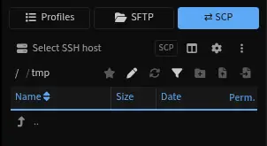

# tabby-sidebar-scp

**Standalone SCP file browser for [Tabby](https://tabby.sh).** Use it on its own, or
install it alongside [Better Sidebar](https://github.com/TooMuhtsh/tabby-better-sidebar).
**Better Sidebar is optional:** this plugin does not depend on it and never modifies
its repository or requires a fork.

### SCP next to Better Sidebar — SFTP-style toolbar (`0.1.1`)



*Real screenshot from [GitHub Actions run #44311878384](https://github.com/p4535992/tabby-sidebar-scp/actions/runs/44311878384), using Tabby 1.0.238 and Better Sidebar 1.0.11. Cropped to the toolbar and file-list header; no UI controls were edited. The test VM has no remote SSH host selected, so this screenshot does not demonstrate a populated remote file listing.*


> **Release 0.1.1:** this version includes the SFTP-style seven-button SCP
> toolbar and remote folder favorites. The SSH/SCP backend and panel mounting
> passed GitHub Actions tests with Tabby 1.0.238, both standalone and with
> Better Sidebar 1.0.11. The optional integration uses DOM selectors, not an
> official API; manual drag-and-drop and cross-platform testing remain necessary.

## SFTP-style toolbar (included in 0.1.1)

The SCP browser uses the **same toolbar order as Better Sidebar's SFTP panel**:
favorite folders (star), edit remote path (pencil), refresh, filter, create
remote folder, upload file, and upload folder. It also provides breadcrumb
navigation, an up-level row, name/size/date sorting, and right-click actions.

- **Star:** save or remove the current remote directory; choose a saved path
  later. Favorites persist in this Tabby installation and are isolated by
  SSH host, username and port.
- **Pencil / breadcrumb:** double-click the breadcrumb or press the pencil
  to type an absolute remote path.
- **New folder:** create a real remote directory over SSH (not a placeholder).
- **Upload file / folder:** use Tabby's Electron native file/directory picker.
  If that picker is unavailable, switch to Local view to choose the source.
- **Filter / view options:** filter is initially collapsed; Local and Split
  remain available for copying and dragging files.
- **SSH settings:** local OpenSSH authentication is separate from Tabby's
  SFTP session, so SSH agent/keys and trusted host keys must be configured.

**Version note:** the toolbar and remote favorites are included in GitHub
release **`0.1.1`**, not the original `0.1.0` archive. Better Sidebar integration
continues to use an optional DOM compatibility adapter rather than an official API.

## Where the SCP panel appears

| Environment | What you see |
| --- | --- |
| Better Sidebar is **running and its profile/SFTP view bar is present** | A third **SCP** tab next to **Profiles** and **SFTP** in Better Sidebar's header. Selecting SCP shows the SCP file browser in that same sidebar. |
| Better Sidebar is **not installed, disabled, or does not expose the expected header** | An **independent SCP sidebar**, with an SCP tab label at the top. It remains usable with native Tabby alone. |
| Better Sidebar appears/disappears while Tabby is running | The SCP browser moves between the two placements; it keeps its current component state. |

**Integration details.** Better Sidebar builds its own sidebar rather than
exporting a public plugin-view extension API. This plugin therefore detects
the existing `.sidebar-plus-content .view-mode-bar` element, adds an SCP tab,
and temporarily hides (without destroying) Better Sidebar's other view contents
while SCP is selected. Clicking **Profiles** or **SFTP** restores the original
contents. When the expected element is absent, SCP mounts as its own sidebar
inside Tabby's window instead. No Better Sidebar source files are changed.

**Compatibility warning:** the optional Better Sidebar integration uses DOM
selectors, **not an officially supported Better Sidebar API**. A future
version may change its classes or structure, in which case SCP falls back to
the standalone sidebar when the expected header cannot be found. A breaking
but still matching DOM change may also require an adapter update. Switching
to standalone mode does not affect the SCP engine.

This plugin does **not** use `BetterPanelContribution:<id>`, because that
contract registers settings pages, not sidebar file-browser tabs.

## File browser and operations

**Remote is the default SCP view**, styled after Better Sidebar's SFTP file
browser. A compact header shows the SSH connection, toolbar, editable path,
file filter and sortable **Name / Size / Date / Perm.** columns. Expand the SSH
settings when choosing a host, user, port or identity key.

Choose **Remote**, **Local**, or **Split** to switch between the remote browser,
local browser and two-pane transfer view. The same SCP interface is used
standalone and when Better Sidebar supplies the `Profiles | SFTP | SCP` tabs.

- **Remote (default):** browse remote directories, with folder navigation,
  hidden-file toggle, filtering and sort controls.
- **Local:** inspect local files and select uploads.
- **Split:** drag between panes to copy or onto a folder in the same pane to move.
- **Upload / Download:** copy the selected file or directory with legacy
  `scp -O`. An upload without a local selection opens the Local view.
- **Rename:** move or rename the selected file within its filesystem, after
  confirmation. **Right-click** on an entry for open/copy/rename actions.
- **Advanced transfer:** explicit source/destination paths, recursion,
  compression and timestamp preservation.

Every transfer and move asks for confirmation. A running SCP transfer can be
cancelled. See [SFTP-inspired UI design](docs/UI_PARITY.md) for the UI behavior
and integration boundaries.

**Copy is not move:** copying between local and remote never deletes the
source. Moves *within* the local or remote filesystem use local `rename` or
remote `ssh mv` respectively and attempt to reject existing destinations;
there is still a possible overwrite race, so avoid concurrent modifications.

### Requirements

- Compatible Tabby plugin runtime (target: Tabby 1.0.231+).
- A local OpenSSH client with **`ssh`** and **`scp`** binaries in PATH.
- `scp` must support `-O` (force **legacy SCP** protocol, not SFTP); the
  SSH server must support the legacy protocol.
- Remote browser requires a POSIX shell and **GNU `find`** (uses `-printf`,
  `-mindepth`, `-maxdepth`). Remote moves require `mv` with `--` support.
- Working noninteractive SSH key/agent authentication and a trusted host key
  in `known_hosts`. Saved Tabby passwords or its open SSH sessions are not reused.
- Remote directories are absolute POSIX paths, beginning with `/`.
- Local filesystem operations use the OS running Tabby. Symbolic links are
  displayed as links; avoid dragging them until their behavior is verified.

**Security:** commands are executed with `shell: false` on the local machine.
Remote arguments are restricted/quoted and SSH host-key checks remain enabled.
Neither file listings nor moves trigger arbitrary remote commands from user
input; they invoke fixed `find` or `mv` templates with quoted paths. SCP
**can overwrite destination files**; every transfer asks for confirmation.
For simple remote filenames, strict SCP filename verification stays enabled.
For shell-quoted remote download names (spaces, punctuation), legacy SCP's
strict filename check rejects the request. Downloading them requires a
**second explicit confirmation** for `scp -T` (which disables that filename
check). Use this only on a trusted SSH server. The advanced dialog exposes
the same opt-in setting.

## Download and install release 0.1.1

The current GitHub release is tagged **`0.1.1`** — **not `v0.1.1`**.
Download the compiled `tabby-sidebar-scp-0.1.1.tgz` package from
[GitHub Releases](https://github.com/p4535992/tabby-sidebar-scp/releases/tag/0.1.1).
Verify it against the accompanying `SHA256SUMS.txt`.

Close Tabby completely and install the local archive into its plugin directory:

```bash
# Linux / macOS (substitute the actual downloaded path)
npm install --prefix "$HOME/.config/tabby/plugins" \
  "/path/to/tabby-sidebar-scp-0.1.1.tgz" --ignore-scripts
```

On Windows, use the Tabby plugins prefix `$env:APPDATA\tabby\plugins`
in PowerShell, then install the downloaded `.tgz` file using `npm install
--prefix`. Restart Tabby completely.

The archive contains the compiled `dist/index.js` entry point. This GitHub
release does not imply publication to the npm registry.

## Build from source and test

```bash
npm install --ignore-scripts
npm test
npm run build
```

For local development, link the built source package into Tabby's plugins
directory and fully restart Tabby. Details and a manual acceptance checklist
are in [docs/DEVELOPMENT.md](docs/DEVELOPMENT.md).

## Source layout

- `src/index.ts` — independent Tabby plugin entry point
- `src/mount.service.ts` — optional Better Sidebar tab and standalone fallback
- `src/scp-browser.component.ts` — remote-first SFTP-inspired file browser
- `src/scp-browser.js` — local listing and SSH remote listing/moves
- `src/scp-core.js` — validated legacy SCP transfers and cancellation
- `src/scp-dialog.component.ts` — advanced transfer dialog
- `test/` — mocked unit tests (no real SSH access)

## Screenshots

### Current SFTP-style SCP panel with Better Sidebar

The screenshot below is from the **new seven-button toolbar**, tested with the
Tabby GUI running on the Ubuntu VM. It shows the SCP tab alongside Profiles and
SFTP, the path breadcrumb, Favorite folders, path editing, Refresh, Filter,
New remote folder, Upload file and Upload folder, plus the sortable
**Name / Size / Date / Perm.** column headers.


Captured from [successful GitHub Actions run #44311878384](https://github.com/p4535992/tabby-sidebar-scp/actions/runs/44311878384).
The [combined-mode artifact](https://github.com/p4535992/tabby-sidebar-scp/actions/runs/44311878384)
also contains the un-cropped application screenshot and renderer diagnostics.

## GitHub Actions test VM

The repository includes a [GitHub Actions VM smoke test](.github/workflows/tabby-vm.yml)
for **both supported layouts**, independent of any local Docker installation.

- **Real SSH/SCP test:** an ephemeral Ubuntu VM starts its own OpenSSH server
  on loopback, creates a temporary SSH key, uploads/downloads a file with
  `scp -O`, compares SHA-256 checksums, and tests directory listing plus
  remote rename. No production server or SSH secret is required.
- **Real Tabby GUI test:** two independent Ubuntu VMs install the official
  Tabby 1.0.238 Linux build, use Xvfb to run its Electron renderer, and check
  the SCP DOM using Chrome DevTools Protocol.
  - **Standalone:** checks that SCP creates its own sidebar without Better Sidebar.
  - **Combined:** installs Better Sidebar 1.0.11, checks that the SCP tab is
    added next to Profiles/SFTP and verifies tab activation and restoration.
- **Evidence:** each GUI job saves screenshots, Electron logs and a JSON
  result as downloadable **Actions artifacts**, including when a test fails.

Go to **Actions → Tabby SCP / Ubuntu VM smoke tests → Run workflow** to run
the workflow manually. The workflow also runs automatically on changes to
the source, CI scripts or its workflow file on `main`.

**Scope and limitations:** GitHub-hosted VMs are temporary and not interactive
remote desktop sessions. The visual assertion checks renderer mounting and
tab switching; full drag-and-drop gestures and visual fidelity still require
manual UI verification. An actual SSH/SCP loopback transfer is verified
automatically. Tabby and Better Sidebar versions are pinned for a repeatable
test target; this does not certify all future releases. The GitHub workflow
does not modify other repositories, create pull requests or upload SSH keys.

## Release automation

The [numeric-tag release workflow](.github/workflows/release.yml) waits for
a **successful main-branch Ubuntu VM smoke test** before creating a release.
It also supports manual `workflow_dispatch` for future versions. Release
identifiers and titles are numeric only, such as `0.1.0`; a leading `v` is
rejected. It builds, runs unit tests, packs a compiled `.tgz` and publishes a
SHA-256 checksum. It does not publish to npm or modify Better Sidebar.

## Publishing to npm (optional)

Tabby's **Settings → Plugins** page has two lists:

- **Installed** plugins are read from Tabby's plugin directory
  (`%APPDATA%\tabby\plugins` on Windows, `~/.config/tabby/plugins` on Linux,
  `~/Library/Application Support/tabby/plugins` on macOS). A local `.tgz`
  install appears here and needs no npm publication.
- **Available** plugins come from the npm registry: Tabby's built-in
  `tabby-plugin-manager` queries
  `https://registry.npmjs.com/-/v1/search?text=keywords%3Atabby-plugin&size=250`
  and keeps only packages whose name starts with `tabby-` or `terminus-`.

This package already satisfies the discovery requirements: unscoped name
starting with `tabby-`, the `tabby-plugin` keyword, a valid semantic version,
and a compiled `dist/index.js`. The `prepack` script builds the bundle, so
publishing from a clean checkout cannot ship an archive without it. The package
is not in Tabby's plugin blacklist.

```bash
npm login
npm publish
```

Publish a normal release to the `latest` dist-tag: Tabby lists the version
advertised by that tag, so a `--tag next` prerelease is not shown. npm search
indexing and Tabby's list refresh can take a few minutes; restart Tabby and
search for `sidebar-scp` or `scp`. Installing from that list uses npm's
Arborist into the plugin directory above, then Tabby restarts.

See the [changelog](CHANGELOG.md) and [0.1.1 release notes](docs/releases/0.1.1.md).

## License

MIT.
