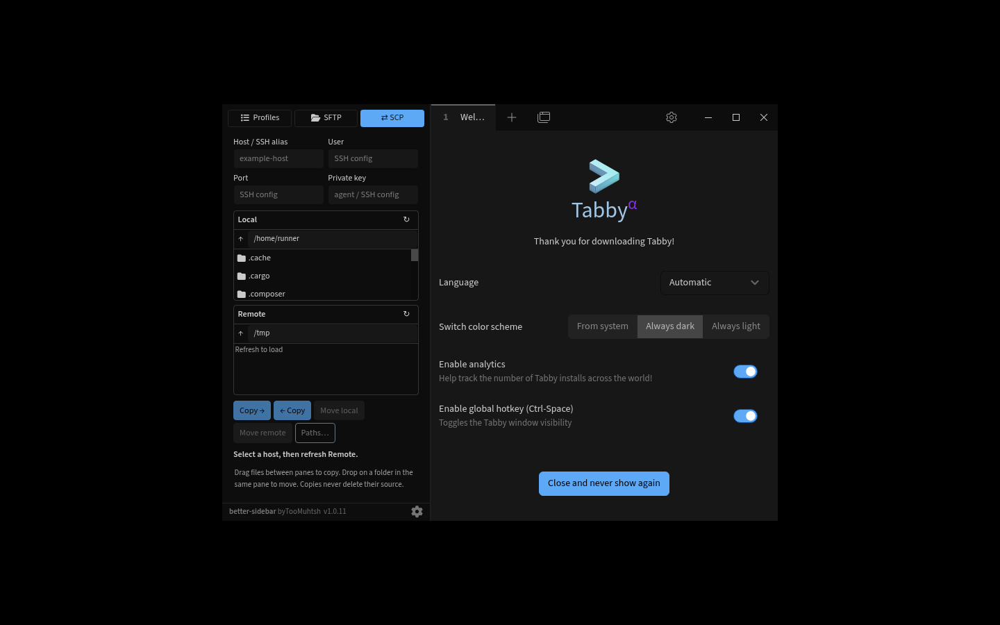
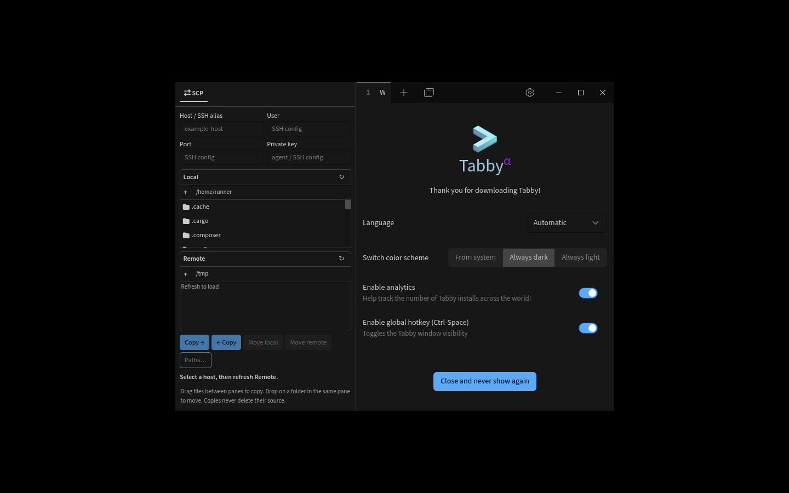
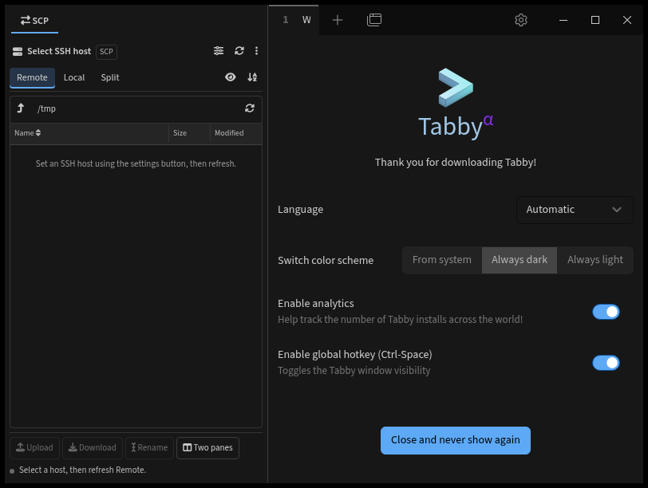

# SCP and SFTP: a consistent Better Sidebar experience

## Goal

SCP should feel like a third view of Better Sidebar, not a competing two-pane
file manager. In particular, selecting **SCP** beside **Profiles** and **SFTP**
should not force users to learn a different layout.

## Default layout

The redesigned view is **remote-first**. It follows this hierarchy:

```text
[ Profiles ] [ SFTP ] [ SCP ]      (tabs supplied by Better Sidebar, when installed)
-----------------------------------------------------
[server name] [SCP]                   [SSH] [refresh] [more]
[ Remote ] [ Local ] [ Split ]         [hidden] [sort]
[ Filter files...                                 ]
[ ↑ ] [ /remote/directory                      ] [⟳]
-----------------------------------------------------
Name                           Size       Modified
📁 directory                   4 KB       18/11/26
📄 file.txt                    8 KB       18/11/26
-----------------------------------------------------
[Upload] [Download] [Rename] [Two panes]
Ready
```

Without Better Sidebar, the plugin supplies its own **SCP** heading. Its file
browser looks the same in either installation mode. The plugin remains fully
independent; no Better Sidebar files or internal Angular components are imported.

## Behavior

- **Remote** is the default view, with a full-height file listing, sortable
  Name/Size/Modified columns, a path bar, and a compact action toolbar.
- **Local** is a secondary view used for selecting upload sources and inspecting
  downloaded files. The current local and remote selections are preserved when
  switching between views.
- **Split** shows both file lists for drag-and-drop transfers. It is available
  when needed but does not consume most of the sidebar by default.
- **SSH connection details** are collapsed behind the settings icon, keeping
  the browser visually similar to the SFTP panel.
- **Filter** and **show hidden files** work on both lists. Sorting keeps
  folders ahead of files. Icon, size, and modified-date metadata are shown
  using the same compact column structure in both views.
- **Right-click** on an entry opens a short context menu for opening folders,
  transferring files and renaming/moving entries.
- **Upload** switches to the Local view to select an item when no source is
  selected; the next Upload action copies it to the remote directory.
- **Download** copies the selected remote entry to the active local directory.
- **Move** within a filesystem preserves the existing confirmation behavior.
  Copying between local and remote keeps the original; it does not perform a
  destructive cross-host move.

## Technical boundaries

This is an **SFTP-inspired interface**, not the original Better Sidebar SFTP
component. There is no supported API that shares that component with another
plugin. The optional Better Sidebar tab injection remains a compatibility
adapter and must be verified whenever Better Sidebar changes its DOM.

The SCP plugin uses local OpenSSH `scp -O` for transfers and SSH/GNU find for
remote file listings. It does not reuse SFTP channels, an active Tabby SSH
session, or Tabby-stored passwords. Remote legacy SCP downloads with complex
filenames retain the existing explicit `scp -T` confirmation rule. No new
file-editing, bookmarks or native OS drag-out behavior is implied by the UI.

## Screenshot provenance

The files under `docs/screenshots/before-*` are **real screenshots from the
prior layout** on disposable GitHub Actions Ubuntu VMs, captured before this
redesign. They are **before** references, not screenshots of the new interface.
New screenshots should be captured after running the existing Xvfb/Electron
GitHub Actions smoke tests against a commit containing this redesign.

## Validation

The frontend source passes TypeScript checking with local framework interface
stubs and the browser backend passes six Node.js tests. These are local checks
only; they do not establish visual parity or prove the Angular template runs in
Tabby. Run the existing GitHub Actions VM workflow and inspect both standalone
and combined screenshots before claiming UI verification.


### Before redesign (real screenshots)

These images document the old two-pane SCP interface and must not be presented
as results from the new SFTP-inspired layout.





### After redesign

The standalone layout passed the GitHub Actions Tabby/Electron smoke test on
the redesigned source. This screenshot is a **real VM capture**, cropped to the
Tabby application window (no UI elements were modified):



The combined Better Sidebar layout is independently tested by the other VM
job. Only publish that image after the combined GUI assertions pass on the
redesigned revision.